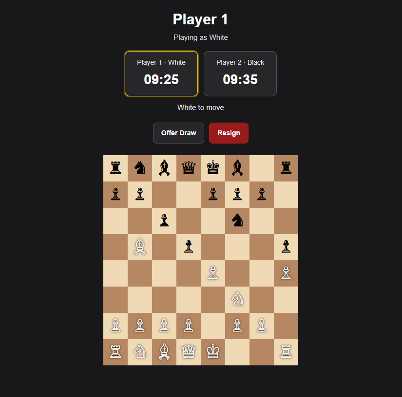
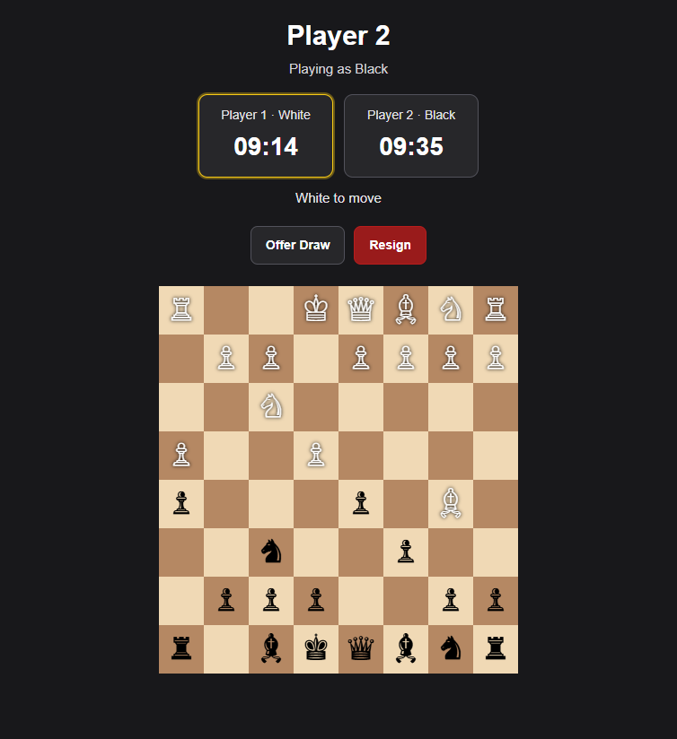
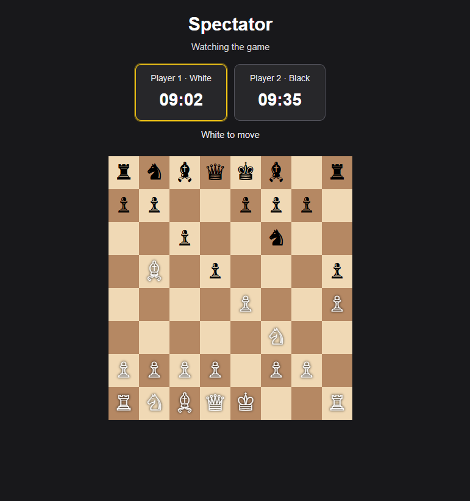

# Real-Time Multiplayer Chess

A browser-based, real-time chess game built with **Node.js, Express, Socket.IO, EJS, and chess.js**. Two players can play a timed match while other visitors watch as spectators.

<p align="center">
  <a href="https://chess-game-w9wn.onrender.com/"><strong>▶ Play the live demo</strong></a>
</p>

<p align="center">
  
  
  
  
</p>

## Screenshots

The screenshots below show the two player views and the spectator view.

<table>
  <tr>
    <td align="center" width="50%">
      <strong>Player 1 — White</strong><br><br>
      
    </td>
    <td align="center" width="50%">
      <strong>Player 2 — Black</strong><br><br>
      
    </td>
  </tr>
  <tr>
    <td colspan="2" align="center">
      <strong>Spectator View</strong><br><br>
      
    </td>
  </tr>
</table>

## Features

- **Real-time multiplayer:** Moves and game state are synchronized with Socket.IO.
- **Two player seats:** The first player takes White, the second takes Black, and additional visitors join as spectators.
- **Spectator mode:** Spectators can see the board, both clocks, draw activity, and the final result without making moves.
- **Server-side move validation:** The server validates moves with `chess.js` and rejects illegal or out-of-turn moves.
- **10-minute chess clocks:** Each player starts with 10 minutes. Only the active player's clock counts down.
- **Draw offers:** A player can offer a draw; the opponent can accept or decline.
- **Resignation:** A player can resign, awarding the result to the opponent according to the game logic.
- **Chess-ending conditions:** Checkmate, stalemate, draw conditions, resignation, and timeout results are handled by the server.
- **Disconnect grace period:** When a player disconnects, a 10-second countdown begins. Reconnecting in time preserves the game; otherwise, the game resets.
- **Reconnect seat reservation:** A returning player can reclaim their seat during the grace period.
- **Interactive board:** Supports click-to-move and drag-and-drop, legal-move highlighting, and a flipped board for Black.
- **Responsive dark interface:** The game can be played or watched from a modern browser.

## Tech Stack

| Technology | Purpose |
| --- | --- |
| Node.js | JavaScript runtime |
| Express | HTTP server and web application |
| Socket.IO | Real-time communication between connected clients |
| chess.js | Chess move validation and game-rule detection |
| EJS | Server-rendered HTML template |
| HTML, CSS, JavaScript | Browser interface and board interaction |
| Render | Hosting and deployment |

## How to Play

1. Open the [live demo](https://chess-game-w9wn.onrender.com/) or run the project locally.
2. The first visitor receives White, the second receives Black, and additional visitors become spectators.
3. The clocks start when both player seats are occupied. White moves first.
4. Make a move by clicking a piece and then a highlighted destination, or by dragging and dropping the piece.
5. Use **Offer Draw** to send a draw offer, or **Resign** to concede the game.
6. If a player disconnects, the game pauses and a 10-second grace period begins. If they reconnect before it expires, the game continues; otherwise, the game resets.

## Run Locally

### Requirements

- Node.js and npm
- Git

### Installation

```bash
git clone https://github.com/NitinDevCodes/CHESS-GAME.git
cd CHESS-GAME
npm install
node app.js
```

Open [http://localhost:3000](http://localhost:3000) in your browser.

To test multiplayer, open two separate browser sessions for the players and a third session for the spectator. Use a private window or a separate browser profile to create an independent session.

## Test the Clocks and Disconnect Reset

The project supports optional environment variables for shortening the clocks and reset grace period during local testing. These settings are not needed for normal gameplay.

**PowerShell (Windows):**

```powershell
$env:CHESS_CLOCK_MS = "20000"
$env:CHESS_RESET_DELAY_MS = "5000"
node app.js
```

This sets each clock to 20 seconds and the disconnect reset grace period to 5 seconds for that terminal session.

To restore the default 10-minute clocks and 10-second reset delay, stop the server with `Ctrl+C`, then run:

```powershell
Remove-Item Env:CHESS_CLOCK_MS -ErrorAction SilentlyContinue
Remove-Item Env:CHESS_RESET_DELAY_MS -ErrorAction SilentlyContinue
node app.js
```

**macOS/Linux:**

```bash
CHESS_CLOCK_MS=20000 CHESS_RESET_DELAY_MS=5000 node app.js
```

## Project Structure

```text
CHESS-GAME/
├── app.js                         # Express server, Socket.IO events, chess state and clocks
├── package.json                   # Project metadata and dependencies
├── package-lock.json              # Locked dependencies, if present
├── public/
│   └── js/
│       └── chessgame.js           # Client board, controls, clocks and socket listeners
├── views/
│   └── index.ejs                  # Page markup and styles
└── docs/
    └── screenshots/
        ├── white-player.png       # White player view
        ├── black-player.png       # Black player view
        └── spectator.png          # Spectator view
```

## Deployment

The live demo is hosted on Render as a Node.js web service:

**Live URL:** https://chess-game-w9wn.onrender.com/

Typical Render settings:

- **Build command:** `npm install`
- **Start command:** `node app.js`
- **Environment variables:** None required for the default configuration. Do not set `CHESS_CLOCK_MS` or `CHESS_RESET_DELAY_MS` in production unless you intentionally want shortened clocks or reset delays.

If automatic deployment is enabled, pushing changes to the configured GitHub branch triggers a new deployment.

## Current Limitations

- **One shared game:** All visitors to the running service join or watch the same match. Multiple independent rooms and matchmaking are not implemented.
- **In-memory state:** The board, player seats, clocks, draw offers, and result are stored in server memory. A server restart or redeployment resets the game.
- **No player accounts or saved history:** The project does not include authentication, persistent games, a move-history database, or PGN export.
- **Demo-oriented reconnect behavior:** A disconnected player has 10 seconds to reclaim their seat. If the countdown expires, the game resets, including when the other player remains connected.

## Possible Future Improvements

- Separate game rooms and invite links
- Move history and PGN export
- Rematch or new-game controls
- Automated integration tests using the real dependencies
- Persistent state for recovery after server restarts

---

Built as a full-stack learning project to explore real-time communication, server-side game validation, chess clocks, reconnection handling, and deployment.
